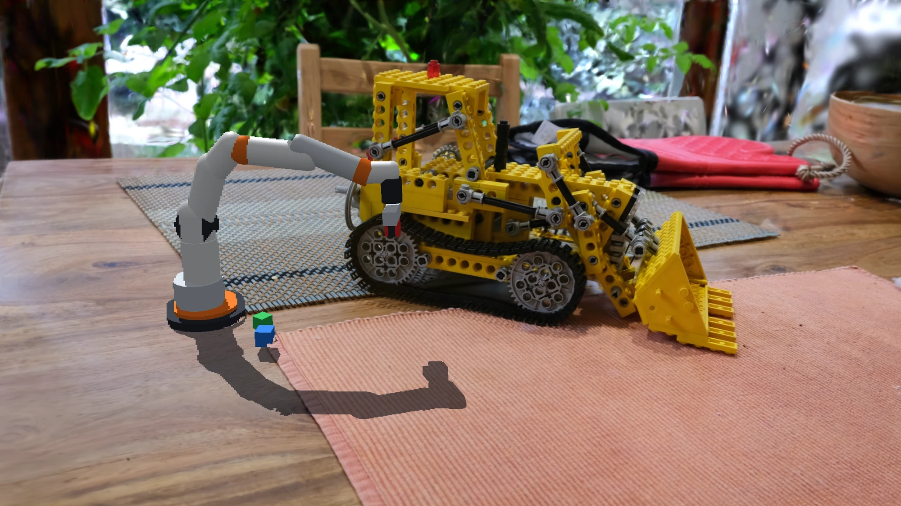
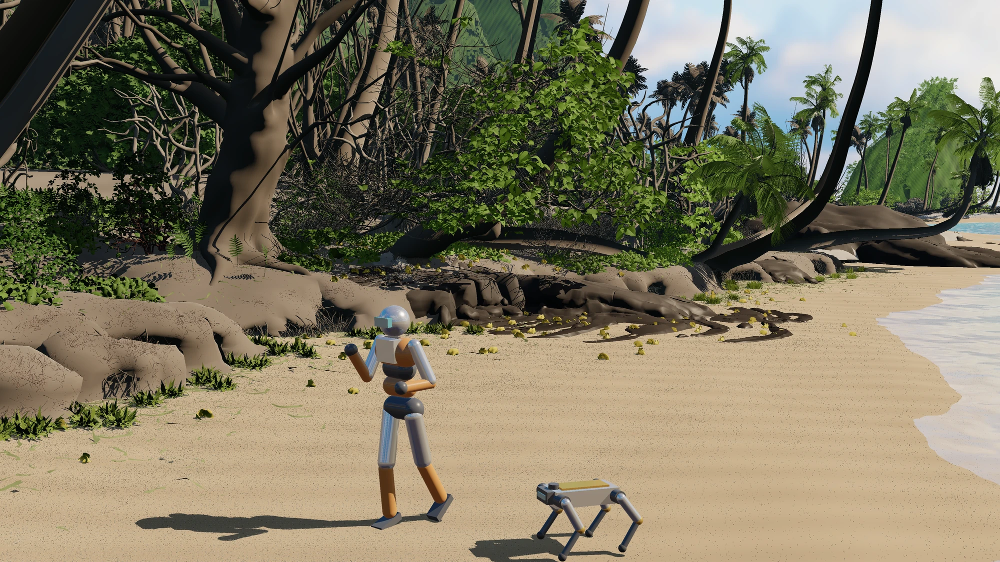

# TPU-RTX

**Native ray casting, Wide-BVH-64 mesh ray tracing, multi-bounce path tracing, 3DGS/4DGS, OpenUSD/Blender compilation, and differentiable Physical AI rendering on Google Cloud TPU v5p.**

**Project Page:** [zaychikliu.github.io/tpu-rtx](https://zaychikliu.github.io/tpu-rtx/) ([English](https://zaychikliu.github.io/tpu-rtx/?lang=en) · [中文](https://zaychikliu.github.io/tpu-rtx/?lang=zh)) · **中文说明:** [README_ZH.md](README_ZH.md) · **License:** [Apache-2.0](LICENSE)

TPU-RTX compiles physics stepping (`mujoco-mjx`), analytic ray casting, 64-ary `Wide-BVH-64` ray/path tracing, chunked-VMEM Gaussian splatting, and BF16 MXU denoising/relighting into a single zero-copy XLA HLO graph on Google Cloud TPU v5p (`host_callbacks = 0`, `send_recv_ops = 0`, `XLA gather_ops = 0`). Workloads scale from 1 chip (`95.74 GiB` HBM) to 4-chip hosts (`383 GiB` HBM) and 8-host 32-chip pods (`3.064 TB` HBM).

---

## Visual Preview

Interactive `4K`/`1080p` videos (`17` clips) and `19` side-by-side comparison sliders against Blender Cycles and Monte Carlo baselines are available on the **[Project Page](https://zaychikliu.github.io/tpu-rtx/)**.

| `RoboWild` 4DGS × MJX (`4K`) | Disney *Moana* OpenUSD × MJX (`22.30B` tris, `4K`) |
|---|---|
|  |  |
| **Blender `Barcelona Pavilion` (`54.91M` unique tris, `4K`)** | **`10M`-Splat Amazon Bistro × MJX Robots (`4K`)** |
|  |  |

---

## Key Measured Results (Google Cloud TPU v5p)

Each benchmark explicitly states its **rendering mode**, **geometry type**, and **resolution**.

| Workload & Mode | Measured Result | Module & Metric Log |
|---|---|---|
| **32-Chip TPU v5p-64 Pod Capstone** (`8` hosts, `3.064 TB` HBM) | **`64×64` Analytic Ray Casting (`B=131k`):** `411,023 env-FPS` (`7.97×` scaling) · **`128²` 3DGS:** `952,248 FPS` / `1.062B` ICI splats · **`128×2048` LiDAR:** `63.88B rays/s` · **`17.18B` unique tris** (`4K` `4.46 s`) · **8K 3-bounce PT (`4.19M` procedural tris):** `1,650.2 spm` (`145.4 ms` @ `4 spp`) | [`run_pod_32chip_capstone.py`](experiments/pod_v5p64_capstone/run_pod_32chip_capstone.py) · [`v3_pod_v5p64_capstone.json`](out/metrics/v3_pod_v5p64_capstone.json) |
| **Analytic Ray Casting: Fused MJX + Shadow (`64×64`, Vision RL)** | `266,209 env-FPS` (`4c`, `B=8,192`, `921,309 FPS` render-equiv, `depth_mae = 3.35e-10 m`) · `Bimanual 72-geom MJX proxy` (not official SAPIEN RoboTwin; `fast_dr`, `1` hard shadow ray): **`41,286 env-FPS`** (`123,858 cam-FPS` across `3` cams, `+0.32%` DR) | `w0_fused_shader` · [`v3_w0_wave2_100k_fps.json`](out/metrics/v3_w0_wave2_100k_fps.json) · [`v3_w1_wave3_replicator.json`](out/metrics/v3_w1_wave3_replicator.json) |
| **Triangle-Mesh `Wide-BVH-64` (Primary + Shadow)** | `MuJoCo Menagerie` (`~393k` tris, `64×64`, `4c`): `Aero Hand 4,284` / `Panda 3,131` / `G1 2,546` / `Go2 1,863 FPS` · `PBD Cloth` (`32,768` tris, `1c`): `973.3 FPS` (`64²`) / `20.39 FPS` (`1024²`) · `Moana` (`22.30B` instanced tris, `4.653 GiB` HBM, `4c`): `4K` `5.13 s` / `8K` `17.24 s` | [`openusd_loader.py`](tpu_mjx_render/adapters/openusd_loader.py) · [`v3_w0_taskA.json`](out/metrics/v3_w0_taskA.json) · [`v3_w2_deformable_cloth.json`](out/metrics/v3_w2_deformable_cloth.json) · [`v3_w2_wave5_moana_8k_mjx.json`](out/metrics/v3_w2_wave5_moana_8k_mjx.json) |
| **Unbiased Multi-Bounce Triangle-Mesh MC Path Tracing** | `1.18M`-tri (`512×512`, `4c`): `3,120.9 spm` (`1-bounce`) / `834.6 spm` (`3-bounce`, `21.88 MRays/s`) / `27.8 spm` @ `4K` · `Blender Classroom` (`606k` tris, `360×640`, `3-bounce`, `16 spp`): **`39.5 spm` (`1c`) / `137.9 spm` (`4c`)** (~100× slower than H100 `14,106 spm` / RTX 5090 `19,202 spm`) · `Lone Monk` (`5.61M` tris, `504×896`, `4-bounce`, `4c`): **`25.7 spm`** | [`tpu_optix.py`](tpu_mjx_render/adapters/tpu_optix.py) · [`v3_w7_wave2_pathtracer_1b_8k.json`](out/metrics/v3_w7_wave2_pathtracer_1b_8k.json) · [`v3_w7_opendata_pathtracer.json`](out/metrics/v3_w7_opendata_pathtracer.json) · [`v3_w7_cinema_pt.json`](out/metrics/v3_w7_cinema_pt.json) |
| **`Wide-BVH-64` G-Buffer + Neural Relighting (`IrradianceNRC3S` & `M2`)** | `Blender` parity: `BMW27` `37.65 dB` (`0.9813` SSIM) · `Monster SSS` `36.98 dB` (`0.121 mm` Z-MAE) · `Barbershop` (`8.55M`, `141` tex) `31.00 dB` · `Barcelona` (`54.91M` tris) `4K` `1.11 img/s` · Static G-buffer relight: `78.60 FPS` `4K` / `307.4 FPS` `1080p` · `4K` BF16 Denoiser `87.78 FPS` · `TPU-DLSS 3.5` `58.93 FPS` @ `4K` | [`blend_compiler.py`](tpu_mjx_render/adapters/blend_compiler.py) · [`tpu_dlss.py`](tpu_mjx_render/adapters/tpu_dlss.py) · [`v3_w5_wave5_bmw_barcelona.json`](out/metrics/v3_w5_wave5_bmw_barcelona.json) · [`v3_w7_barbershop_cinema.json`](out/metrics/v3_w7_barbershop_cinema.json) · [`v3_w4_wave5_relight_quant.json`](out/metrics/v3_w4_wave5_relight_quant.json) |
| **3DGS / 4DGS & Real-World `Mip-NeRF 360`** (`4c`) | `142,008 FPS` (`64×64`, `30.1×` over V2 `jax_tile`) · `300,000,000` Gaussians in `301.87 GB` HBM @ `4K` (`0.25 FPS`) · `8K garden` (`5.83M` SH3) `0.88 FPS` (`29.19 MPix/s`) · `32`-view `jax.grad` `31.31 dB` peak (`17.1 s`) · `4DGS × MJX` `5.32 FPS` `1080p` | [`tpu_gsplat.py`](tpu_mjx_render/adapters/tpu_gsplat.py) · [`v3_w3_gs3d_v3.json`](out/metrics/v3_w3_gs3d_v3.json) · [`v3_w3_wave6_4dgs_300m.json`](out/metrics/v3_w3_wave6_4dgs_300m.json) · [`v3_w3_wave7_8k_and_gradtrain.json`](out/metrics/v3_w3_wave7_8k_and_gradtrain.json) |
| **Embodied AI, Tactile, `Sim-to-VLA` & `LiDAR`** (`64×64` / Rig) | `1M` Factory frames `142.6 s` (`ViT-Tiny` VLA `7,143 FPS`) · `GelSight` `270.6k/s` · `Cartpole` PPO `656.4k env/s` · `jax.grad` Servoing `36.08 dB` (`1.63 cm` EE) · `8×1080p + 2×128×2048` LiDAR (`3.13e-8 m` MAE) | [`mjx_universal.py`](tpu_mjx_render/adapters/mjx_universal.py) · [`isaac_replicator.py`](tpu_mjx_render/adapters/isaac_replicator.py) · [`v3_w1_wave4_vla_tactile_factory.json`](out/metrics/v3_w1_wave4_vla_tactile_factory.json) |

---

## Installation & Quickstart

### Install

```bash
git clone https://github.com/ZaychikLiu/tpu-rtx.git
cd tpu-rtx
pip install -e .
# Optional OpenUSD loader support:
pip install -e ".[usd]"
```

### SDK Quickstart

```python
import tpu_rtx

scene = tpu_rtx.compile(mj_model, shader="fused_ao_ggx", res=(128, 128), sharding="auto")
obs = tpu_rtx.render(mjx_data, scene)  # → {"rgb", "depth", "normal", "seg_id", "flow"} in TPU HBM
```

### Tests & Harnesses

```bash
pytest tests/                         # Unit, HLO zero-copy, and primitive parity tests
python gate.py --help                 # Locked Phase-0 parity & Stage-2 quality gate evaluator
python bench.py --help                # JIT-warmed multi-chip E2E benchmark runner
```

---

## Software Adapters (`tpu_mjx_render/adapters/`)

| Target Interface | Adapter Module | Scope |
|---|---|---|
| **MuJoCo / MJX & Menagerie** | [`mjx_universal.py`](tpu_mjx_render/adapters/mjx_universal.py) | Compiles `MjModel`, MJCF XML, and multi-mesh Menagerie assets to `Wide-BVH-64` + analytic primitives, with `jax.grad` differentiable servoing |
| **NVIDIA Isaac Sim & Replicator** | [`isaac_replicator.py`](tpu_mjx_render/adapters/isaac_replicator.py) | `TiledCamera` (`RGB/Depth/Normal/Seg/Flow`), `rep.randomizer.*` XLA domain randomization, `128×2048` RTX LiDAR, and `GelSight` tactile kernels |
| **Blender 4.x / Cycles `.blend`** | [`blend_compiler.py`](tpu_mjx_render/adapters/blend_compiler.py) | Parses Cycles shader graphs (`Principled`/`Glass`/`Glossy`/`SSS`) and Depsgraph instances into TPU `ScenePack` + `AgX` (with neural relighting for Cinema parity) |
| **Pixar / Disney OpenUSD** | [`openusd_loader.py`](tpu_mjx_render/adapters/openusd_loader.py) | Loads `.usd/.usda/.usdc/.usdz` (`UsdGeom.Mesh`, `PointInstancer`, `BasisCurves`) into 2-level `Wide-TLAS-64` |
| **NVIDIA OptiX Python API** | [`tpu_optix.py`](tpu_mjx_render/adapters/tpu_optix.py) | `OptixDeviceContext`, `accelBuild(GAS/IAS)`, `ShaderBindingTable`, `optixTrace`, multi-bounce path tracing, and dynamic cloth BVH refit |
| **`gsplat` 3DGS / 4DGS** | [`tpu_gsplat.py`](tpu_mjx_render/adapters/tpu_gsplat.py) | Chunked-VMEM EWA rasterizer, `32`-view `jax.grad` training, and `SE(3)` dynamic 4DGS |
| **NVIDIA DLSS 3.5 & Denoiser** | [`tpu_dlss.py`](tpu_mjx_render/adapters/tpu_dlss.py) | `4×4` motion-vector reprojection, `YCoCg` clamp, BF16 MXU `2×` SR, `4K` MC denoiser, and static G-buffer relighting |
| **SIGGRAPH ReSTIR DI** | [`tpu_restir.py`](tpu_mjx_render/adapters/tpu_restir.py) | Streaming `M=32` RIS and spatiotemporal reservoir resampling across `1,024` dynamic lights |

**Benchmark Coverage:**
- **Measured on TPU v5p:** `72-Geom Bimanual MJX Proxy`, `RoboWild` (3DGS/4DGS × MJX), `MuJoCo Menagerie`, `Factory Sim-to-VLA + GelSight`, `Vision PPO` (`Cartpole`/`Panda`/`Humanoid-21DOF`), `Autonomous 8×1080p + 2×128×2048 LiDAR`, `Blender Open Data / Studio` (8 scenes), `Disney Moana OpenUSD` (`22.30B` tris), and `Mip-NeRF 360` + `10M Bistro`.
- **Compatible Drop-In Targets:** Standard MJCF XML, OpenUSD `.usd`, and `rep.randomizer` suites (`RoboDojo`, `MuJoCo Playground`, `ALOHA`, `ManiSkill`) compile via `tpu_rtx.compile(...)`; dedicated per-suite JSONs are not yet recorded in [`out/metrics/`](out/metrics/).

---

## Hardware Tradeoffs, Memory Access & Limitations

- **Memory Access Precision (`XLA gather_ops = 0` vs. Pallas DMA):**
  - *MJX analytic ray casting & differentiable 3DGS scan*: strictly zero gather (static unrolled primitive loop / `jax.lax.sort` carrying payload).
  - *3DGS fast forward*: zero HBM gather (contiguous VMEM blocks), using on-chip 128-lane VPU `take_along_axis`.
  - *Triangle-mesh `Wide-BVH-64`*: emits **`0` XLA `gather(` ops** and **no per-ray HBM gather**; inside Pallas Mosaic `custom-call`, coherent `8×16` (128-ray) packets issue tile-granular contiguous `4 KB` / `12 KB` `pltpu.async_copy` DMAs, with triangle geometry and vertex normals packed inline in `(N_leaves, 24, 128)` SoA leaves to avoid secondary `tri_id` attribute lookups.
- **Where TPU v5p works well:** Large-capacity HBM (`95.74 GiB`/chip, `3.064 TB` per 32-chip pod) holds `1.062B` splats or `22.30B`-tri *Moana* without host paging; low-res `64×64` Vision RL physics + rendering + gradients stay fused in one XLA graph (`host_callbacks = 0`); BF16 MXUs run `4K` neural denoising/relighting at `78–88 FPS`.
- **Where GPUs remain significantly faster:** Interactive DCC viewports (`Omniverse`, Blender, Unreal), sub-second startup without XLA's `4–130 s` cold compile latency, incoherent multi-bounce branching on hardware RT cores, and **pure multi-bounce triangle-mesh Monte Carlo path tracing** — e.g., on `Blender Classroom` (`606k` tris, 3-bounce, `360×640`), 4-chip TPU v5p achieves `137.9 spm`, ~`100×` slower than a single H100 (`14,106 spm` exact / `55,148 spm` NRC) or RTX 5090 (`19,202 spm`) reported in Chai et al. (2026, `wenhaochai/rtx-h100`).

---

## Repository Structure

```text
tpu-rtx/
├── tpu_rtx/             # Public entry point (compile / render)
├── tpu_mjx_render/      # Core Pallas Mosaic kernels, Wide-BVH-64, 3DGS, & 8 adapters/
├── experiments/         # Live TPU v5p benchmarks & video capture workers (see experiments/README.md)
├── docs/                # Bilingual project page (HTML/CSS/JS) & rendered WebP/MP4 assets
├── scripts/             # Shell runners, Cycles GT export, PPO & figure scripts
├── tests/               # Unit, HLO zero-copy, and primitive parity tests
├── out/                 # Verified telemetry JSONs (out/metrics/) and figures (out/figures/)
├── notes/               # Archived V1/V2 milestone reports (see notes/README.md)
├── bench.py             # Multi-chip E2E benchmark harness
├── gate.py              # Locked parity and image-quality gate evaluator
└── pyproject.toml
```

---

## Third-Party Assets & References

- **Walt Disney Animation Studios *Moana Island Scene* (v2.1):** Used under the Disney *Moana Island Scene* non-commercial license; original geometry and OpenUSD scene © Walt Disney Animation Studios.
- **Blender Open Data / Blender Studio** (*BMW27*, *Barcelona Pavilion*, *Barbershop*, *Classroom*, *Junkshop*, *Lone Monk*, *Monster Under the Bed*, *Fishy Cat*): CC0 / CC-BY via Blender Foundation & Blender Studio.
- **Mip-NeRF 360** (`garden`, `bicycle`, `kitchen`, `bonsai`, `counter`, `stump`): Photogrammetry captures by Barron et al.
- **Google DeepMind `mujoco_menagerie`:** Apache-2.0 / BSD robot models (`Franka Panda`, `Unitree G1`, `Unitree Go2`, `Tetheria Aero Hand`).
- **Chai et al. (2026):** `wenhaochai/rtx-h100` H100 / RTX PRO 6000 Cycles benchmark methodology and comparison data.

---

## Citation

```bibtex
@misc{liu2026tpurtx,
  author       = {Feiyang Liu},
  title        = {TPU-RTX: Native Ray Tracing and Physical AI Rendering on Google Cloud TPU v5p},
  year         = {2026},
  howpublished = {\url{https://github.com/ZaychikLiu/tpu-rtx}},
  note         = {Project page: \url{https://zaychikliu.github.io/tpu-rtx/}}
}
```
