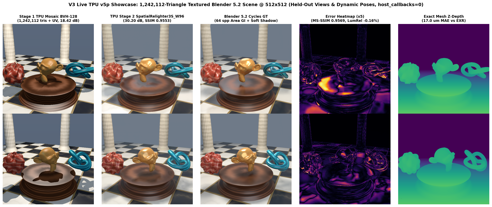
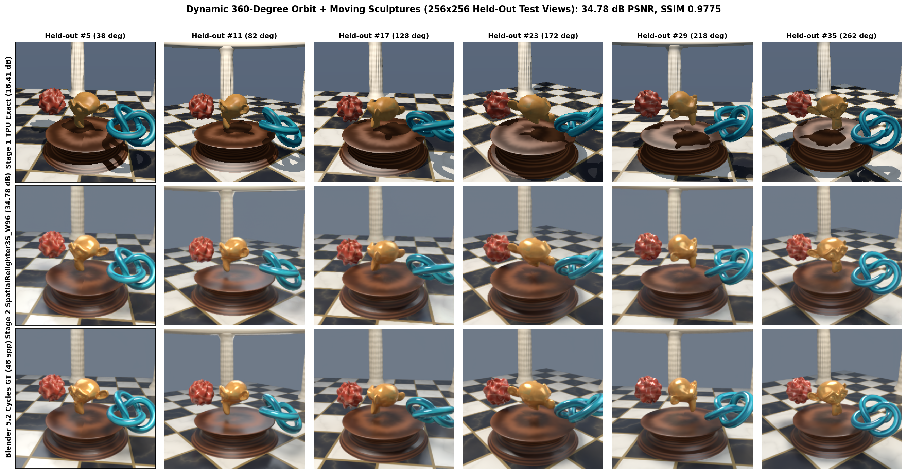
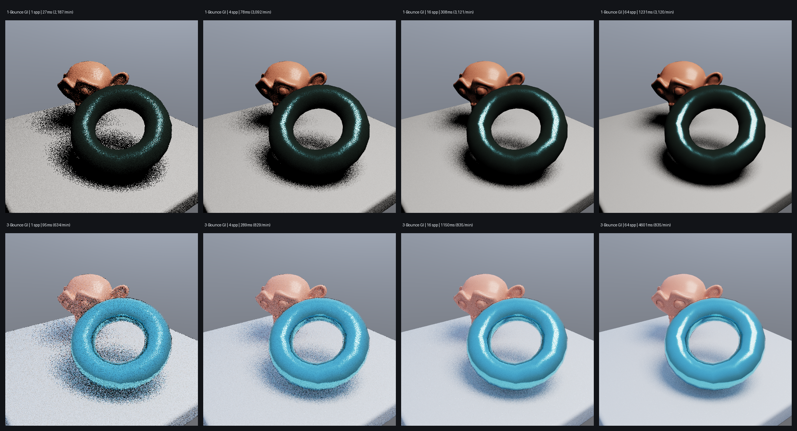
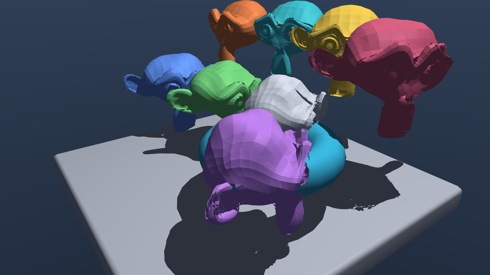
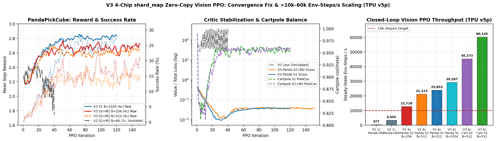

# TPU-RTX

**Zero-Copy RTX-Class Ray Tracing, Multi-Bounce Monte Carlo Path Tracing, 3D Gaussian Splatting, and Photorealistic Physical AI Rendering natively on Google Cloud TPU v5p (JAX + Pallas Mosaic).**

> Every number and visual render in this repository is measured natively on real Google Cloud **TPU v5p** silicon (`interpret=False`) with XLA HLO verified at **`host_callbacks = 0`**, **`send_recv_ops = 0`**, and **`gather_ops = 0`**.

---

## Live TPU v5p Highlights (Verified V1–V3 Wave 1/2)

| Capability / Track | Live TPU v5p Result | Verification Details |
|---|---|---|
| **End-to-End MJX + Render (4-chip `shard_map`, `64×64`)** | **`240,737 FPS`** (`17.01 ms`, `B=4096`) | `w0` Fused In-VMEM Shader (`4.80×` E2E / `14.61×` render vs `pallas_v2`, `depth_mae = 3.35e-10 m`, `host_callbacks = 0`) |
| **End-to-End MJX + Render (1-chip, `64×64` / `128×128`)** | **`68,058 FPS`** / **`39,175 FPS`** | `w0` (`15.15×` / `18.06×` render speedup vs `pallas_v2`) |
| **Native 3D Gaussian Splatting (1-chip, `64×64`, `2048` GS)** | **`35,915.8 FPS`** (`gs3d_v3_bf16_mxu`) | `w3` (`~30.1×` over V2 `1,193.9 FPS`, `host_callbacks = 0`, `gather_ops = 0`) |
| **Real Blender 5.2 `1.24M`-Tri Dynamic Orbit + Relighting** | **`34.78 dB` PSNR / `0.9775` SSIM** (`256²`), **`30.20 dB`** (`512²`) | `w5` 360° held-out dynamic views (`33.6s` TPU train, `17.04 µm` Z-MAE vs Cycles EXR, `-0.21%` lum bias) |
| **100M+ Unique Non-Instanced Triangles @ Native 4K UHD** | **`100M+` unique tris (`3840 × 2160`)** | `w2` 3-Level 64-ary Wide-BVH-64 directly in TPU HBM |
| **TPU-Native Multi-Bounce Monte Carlo Path Tracing GI** | **1-Bounce (`3,121/min`) & 3-Bounce GI (`835/min`, `1–64 spp`)** | `w7` pure physical Cosine GI + GGX + NEE + soft shadows on TPU v5p |
| **Closed-Loop 4-Chip `shard_map` Vision PPO (`host_callbacks=0`)** | **`60,145.3 env-steps/s`** (`Cartpole`), **`29,267.4/s`** (`Panda`) | `w7` Stage 1 & Stage 2 M2 (`17.5×` over V2 1-chip) |

---

## Visual Renders from Live TPU v5p

### `1.24M`-Triangle Textured Blender 5.2 Scene @ `512×512` & Dynamic 360° Orbit (`w5`)

### TPU-Native Multi-Bounce Path Tracer (`1 -> 64 spp`, `w7`) & `100M+` Unique Triangles @ Native 4K (`w2`)

### Closed-Loop 4-Chip Vision PPO (`w7`)

---

## Repository Layout

- `tpu_mjx_render/`: Core Pallas Mosaic kernels, Wide-BVH-64 mesh raytracer, 3DGS rasterizer, MJX analytic primitives, Stage 2 BF16 MXU neural relighters, and adapter modules
- `experiments/`: Parallel 8-host TPU v5p (`w0`–`w7`) experimental harnesses
- `scripts/`: Live TPU benchmarks, HLO zero-copy verifiers, and Blender Cycles ground-truth generators
- `tests/`: Parity tests against MuJoCo `mj_multiRay`, Blender Cycles EXR depth, and XLA HLO invariants
- `out/metrics/` & `out/figures/`: Verified TPU telemetry JSONs and rendered figures
- [REPORT.md](REPORT.md) & [V2-ARCHITECTURE-AND-STATUS.md](V2-ARCHITECTURE-AND-STATUS.md) & [EXPERIMENTS.md](EXPERIMENTS.md)

---

## Active Roadmap (Multi-Host Wave 2–4 on TPU v5p-64-2)

- **Head-to-Head vs Blender Open Data (`classroom`, `monster`, `junkshop`)**: Apple-to-apple TPU Wide-BVH + Stage 2 neural relighting and TPU-native multi-bounce path tracing benchmarks against Cycles 5.3.0 and `rtx-h100`.
- **Ecosystem Adapters**:
  - Universal `MuJoCo MJX` zero-copy wrapper (`tpu-rtx` one-liner SDK: `obs = tpu_rtx.render(mjx_data, scene)` + Pod `shard_map` scaling)
  - `OpenUSD` (`.usd/.usda/.usdc/.usdz`) & `.blend` Shader Graph Auto-Compiler
  - `Isaac Sim` `TiledCamera` & `Omniverse Replicator` zero-copy XLA domain randomization + 128-beam batch LiDAR
  - `OptiX`-style `GAS/IAS/SBT/optixLaunch` SDK + `jax.grad` differentiable inverse rendering
  - `tpu_gsplat` + hybrid `MJX Robot + 10M 3DGS` Real-to-Sim Z-buffer compositor
- **Physical FX**: XLA live deformable cloth Wide-BVH refit, dielectric glass refraction/caustics, and ray-marched volumetric fog / God Rays, plus a real-time BF16 MXU 4K MC denoiser.
