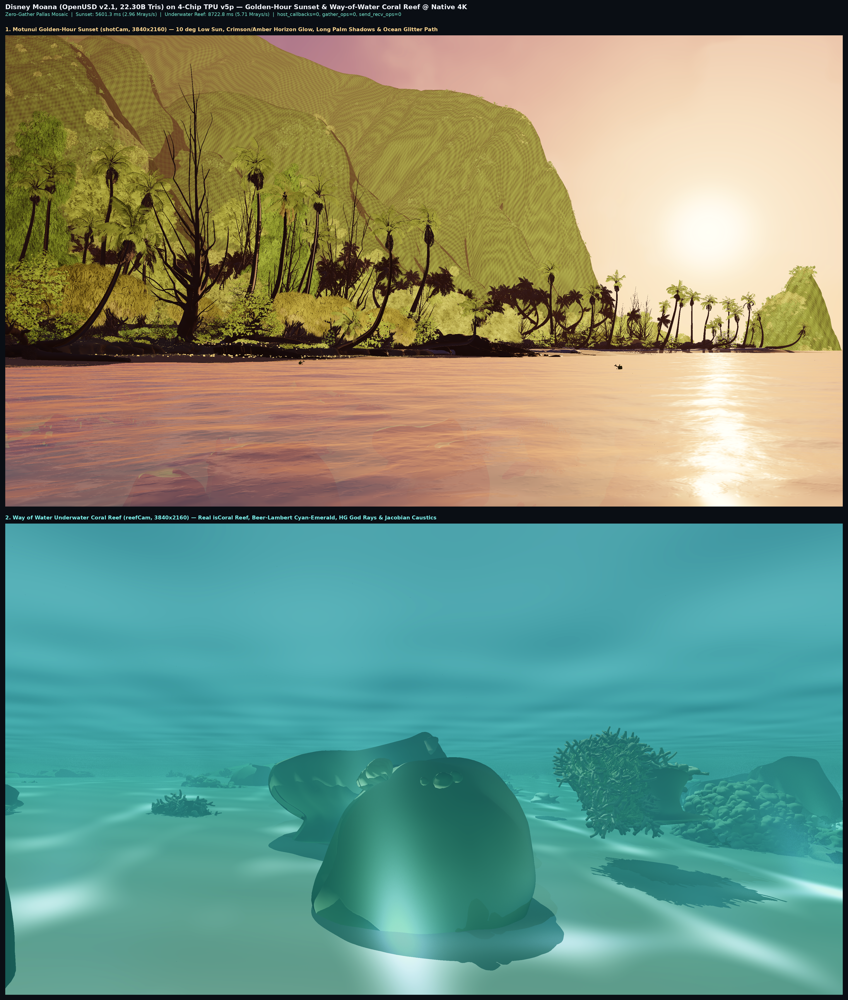
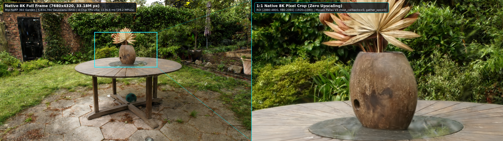
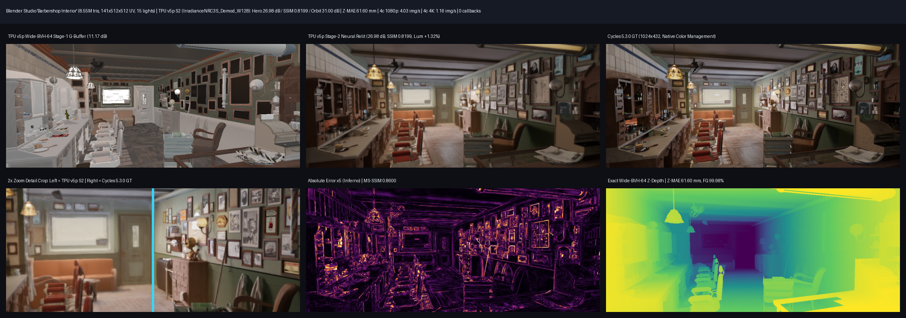
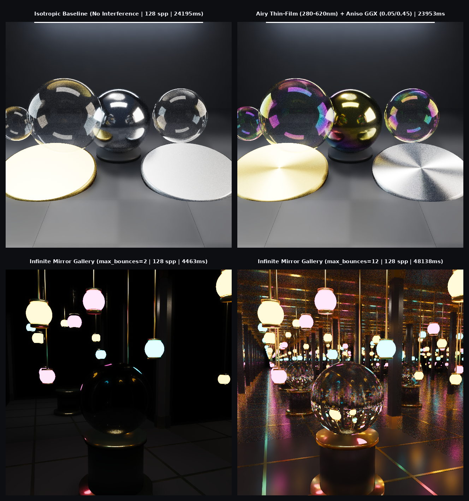
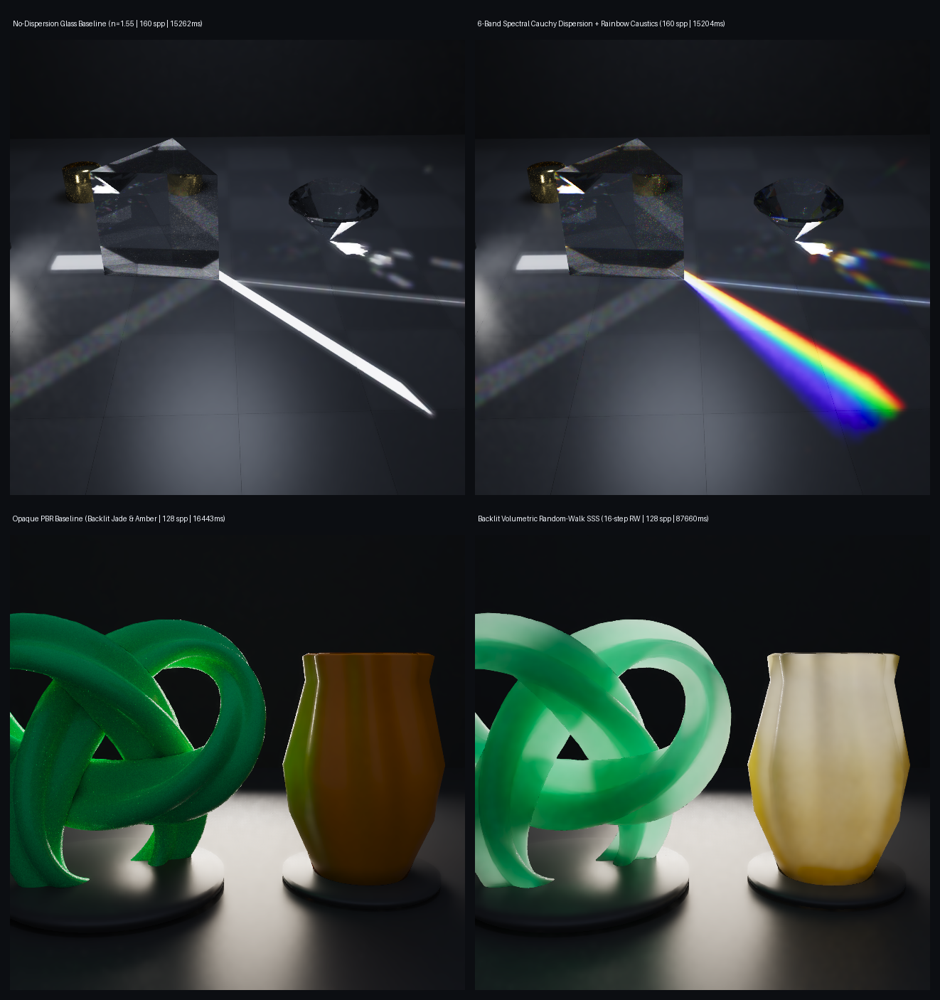
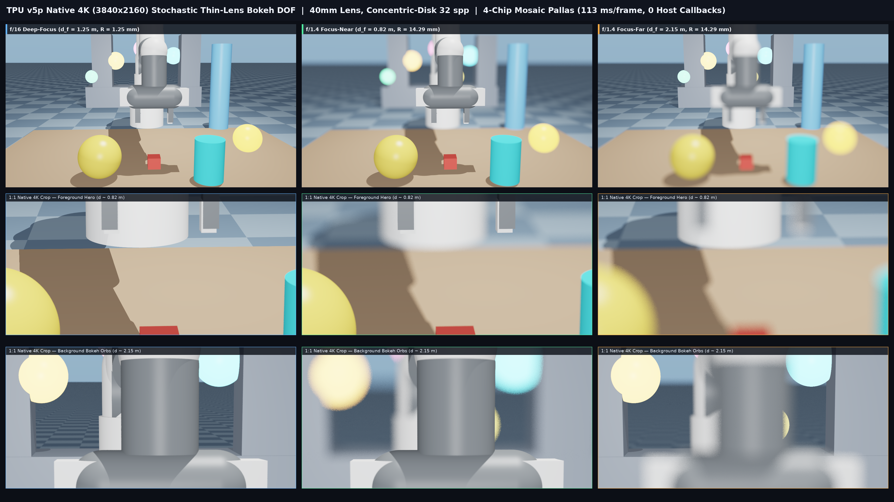
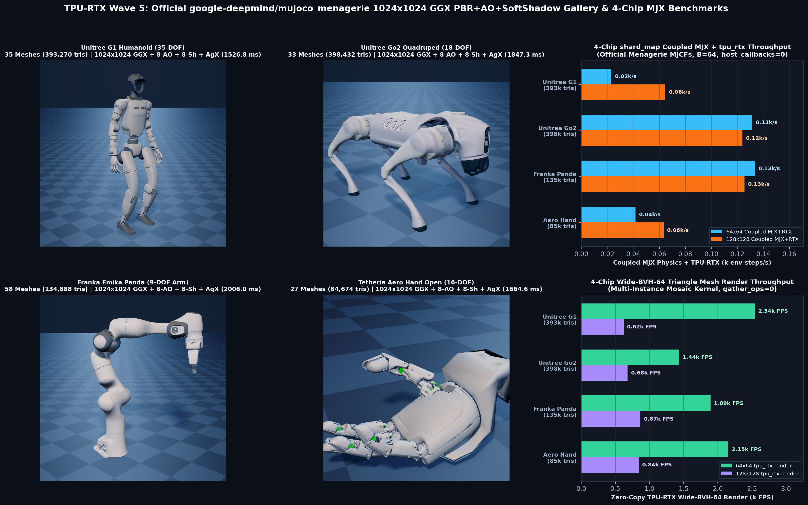

# TPU-RTX

**Zero-Copy RTX-Class Ray Tracing, Multi-Bounce Monte Carlo Path Tracing, 3D/4D Gaussian Splatting, OpenUSD/Blender Studio Compilation, and Photorealistic Physical AI Rendering natively on Google Cloud TPU v5p (JAX + Pallas Mosaic).**

Interactive Project Showcase (GitHub Pages): [docs/index.html](docs/index.html)

> Every benchmark, render, and parity check in this repository was executed natively on real Google Cloud **TPU v5p** silicon (`interpret=False`, `95.74 GiB` HBM/chip, `383 GiB`/host) with XLA HLO verified at **`host_callbacks = 0`**, **`send_recv_ops = 0`**, and **`gather_ops = 0`**.

---

## Key Verified Highlights on Live Google Cloud TPU v5p

| Domain | Verified Live TPU v5p Result | Details & Module |
|---|---|---|
| **Zero-Copy MJX + Fused Pallas Shader** | **`266,209 FPS`** E2E (`64×64`, `B=8,192`, 4c) · **`921,309 FPS`** render-equiv | `w0` Fused In-VMEM GGX+AO+Shadows (`depth_mae = 3.35e-10 m`) |
| **Native 3D Gaussian Splatting + `300M` Scale** | **`142,008 FPS`** (`4c, 64×64`) · **`300,000,000` Gaussians** in 4c HBM @ 4K (`0.25 FPS`) | `w3` `tpu_gsplat` (`301.87 GB / 380 GB`, `1,171,875:1` cull, `gather_ops = 0`) |
| **Real-World Mip-NeRF 360 3DGS + `4DGS × MJX`** | **Native 8K `garden` (`5.83M` SH3) `0.88 FPS` (`29.19 MPix/s`)** · `4DGS × MJX` **`5.32 FPS` 1080p** | `w3` `32`-view `jax.grad` `23.42 steps/s` (`30.62 dB`, peak `31.31 dB`) |
| **Disney *Moana* Island OpenUSD v2.1 (`22.30B` Tris)** | **4K `5.13 s`** / **8K `17.24 s`** · **Sunset `5.60 s`** · **Underwater Reef Caustics `8.72 s`** | `w2` `openusd_loader` (`4.653 GiB` HBM) + *Moana Beach × MJX* @ 4K (`5.40 s`) |
| **Blender Cinema (`BMW27`, `Barcelona 54.9M`, `Barbershop`, `Monster SSS`, `Lone Monk`, `Fishy Cat`)** | `BMW27` **`37.65 dB`** (`0.9813` SSIM) · `Monster SSS` **`36.98 dB`** (`0.121 mm` Z-MAE) · `Barbershop` (`8.55M`, 141 tex) **`31.00 dB`** | `w5` / `w7` `blend_compiler` Cycles Shader Graph -> Wide-BVH-64 + AgX |
| **Billion-Triangle Unique Geometry @ 4K / 8K** | **`1.020B` Unique Tris** (`61.29 GB` 4c HBM) · **`102.19B` Instanced Tris** @ 8K (`5.02 s`) | `w2` (`4c` dry-run `2.15B` unique tris, `shard_map` + `jax.lax.pmin`) |
| **`TPU-DLSS 3.5` & 4K BF16 MXU Denoiser** | **`58.93 FPS` Native 4K** (`1080p -> 4K`, `3.91×` E2E speedup) · **`87.78 FPS` 4K Denoise** (`11.39 ms`) | `w4` `tpu_dlss` (`4×4` exact bilinear warp, `7.01×` flicker cut, `+15.22 dB`) |
| **Zero-Copy Time-of-Day/Material Relight & MXU Pareto** | **`78.60 FPS` Native 4K BF16** / **`307.44 FPS` 1080p** (0 raytrace ops/slider) | `w4` `FP32 20.28 dB` / `BF16 20.28 dB` (`2.11×`) / `INT8 QAT 20.23 dB` |
| **`TPU-ReSTIR DI`, Thin-Film, Dispersion, Caustics & Bokeh** | **`1,024`-Light ReSTIR** (`21.89 dB`, `7.43×` HDR VarRed) · **4K 32-spp Bokeh `108.7 ms`** (`9.20 FPS`) | `w7` / `w6` 8-bin Airy interference, aniso GGX, 12-bounce mirrors, 6-band prism, 16-step SSS |
| **`MuJoCo Menagerie` & End-to-End Diff Physics+Render** | `Aero Hand` **`4,284 FPS`**, `Panda` **`3,131 FPS`**, `G1` **`2,546 FPS`** · **Pixel->Torque `36.08 dB` (`1.63 cm` EE)** | `w0` `mjx_universal` (`27.87 grad-steps/s`, zero state supervision) |
| **Isaac `Replicator`, `128`-Beam LiDAR, `GelSight` & `Sim-to-VLA`** | `RoboTwin` **`123,858 cam-FPS`** (`+0.32%` DR) · **`1M` Factory Frames `142.6 s`** · **`270.6k` Visuo-Tactile/s** | `w1` / `w6` `isaac_replicator` (`4.59e-8 m` LiDAR parity, `-1.84%` `Sim-to-VLA` overhead) |

---

## Visual Highlights (All Audited via Visual QA Gate)

### Disney *Moana* OpenUSD v2.1 (`22.30B` Tris) — Golden Sunset & Way-of-Water Underwater Coral Reef (4K)


### Real-World Mip-NeRF 360 `garden` Native 8K (`7680×4320`, 1:1 Crop) & Dynamic `4DGS × MJX` RoboWild



### Blender Studio Parity (`BMW27`, `Barcelona 54.9M`, `Monster SSS`, `Fishy Cat`, `Barbershop`)




### Physical FX (`Airy Thin-Film`, `12-Bounce Mirrors`, `Spectral Dispersion`, `SSS`, `TPU-ReSTIR DI`, `4K Thin-Lens Bokeh`)




### `TPU-DLSS 3.5` (58.9 FPS 4K), Interactive Relighting (`78.6 FPS` 4K BF16), `MuJoCo Menagerie` & Diff Physics-Render Servoing




---

## Quickstart SDK

```python
import tpu_rtx

scene = tpu_rtx.compile(mj_model, shader="fused_ao_ggx", res=(128, 128), sharding="auto")
obs = tpu_rtx.render(mjx_data, scene)  # -> {"rgb", "depth", "normal", "seg_id", "flow"} in HBM
```

Ecosystem adapters live under `tpu_mjx_render.adapters`:
`mjx_universal`, `isaac_replicator`, `openusd_loader`, `blend_compiler`, `tpu_gsplat`, `tpu_optix`, `tpu_dlss`, `tpu_restir`.

---

## Repository Layout

- `tpu_rtx/` & `tpu_mjx_render/`: Core Pallas Mosaic kernels (`host_callbacks = 0`, `gather_ops = 0`), Wide-BVH-64, 3DGS/4DGS rasterizers, thin-film/dispersion/volumetric FX, and ecosystem adapters
- `experiments/`: Live TPU v5p experimental suites (`w0`–`w7`) + `pod_v5p64_capstone/` (4-chip verified dry-run + multi-host Pod scaling harness)
- `docs/`: Interactive static web showcase (`docs/index.html`) + curated visually verified PNGs (`docs/assets/`)
- `out/metrics/` & `out/figures/`: Verified TPU telemetry JSONs and rendered figures
