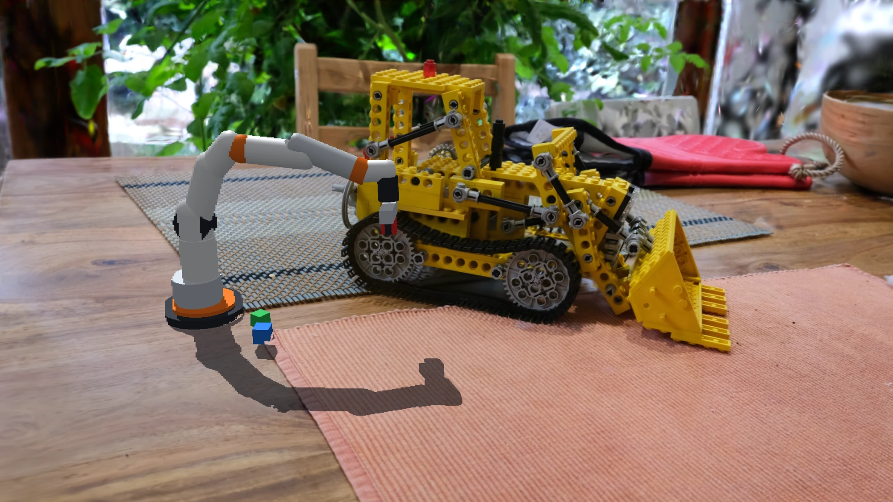
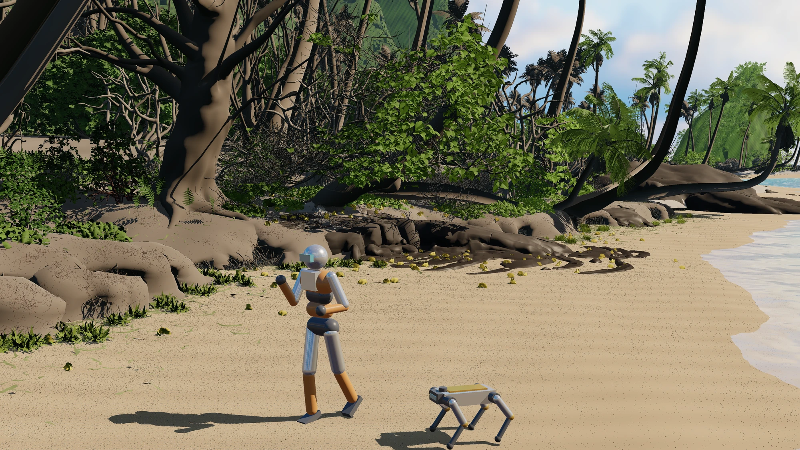
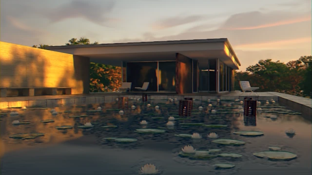
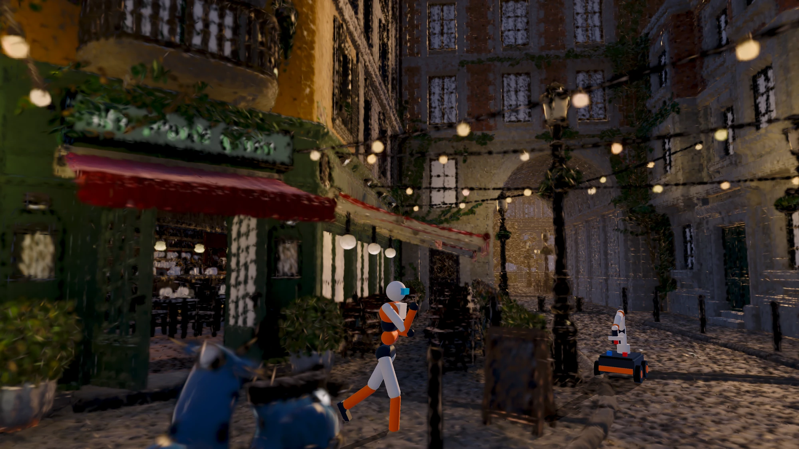

# TPU-RTX

**基于 Google Cloud TPU v5p 的原生光线追踪、路径追踪、3DGS/4DGS、OpenUSD/Blender 编译与可微具身智能渲染系统。**

**项目主页：** [zaychikliu.github.io/tpu-rtx](https://zaychikliu.github.io/tpu-rtx/?lang=zh)（[中文](https://zaychikliu.github.io/tpu-rtx/?lang=zh) · [English](https://zaychikliu.github.io/tpu-rtx/?lang=en)） · **English README:** [README.md](README.md) · **开源协议：** [Apache-2.0](LICENSE)

TPU-RTX 将物理仿真步进（`mujoco-mjx`）、64 叉 `Wide-BVH-64` 光线/路径追踪、分块 VMEM 高斯溅射与 BF16 MXU 降噪重打光编译在同一张零拷贝 XLA 计算图内（`host_callbacks = 0`、`send_recv_ops = 0`、`gather_ops = 0`），支持从单芯（`95.74 GiB` HBM）、单机 4 芯（`383 GiB` HBM）扩展至 8 机 32 芯 TPU v5p-64 集群（`3.064 TB` HBM）。

---

## 渲染预览

完整的 `17` 段 `4K`/`1080p` 实机渲染视频与 `19` 组交互式画质对比滑块（对照 Blender Cycles 与蒙特卡洛参考）请见 **[项目主页](https://zaychikliu.github.io/tpu-rtx/?lang=zh)**。

| `RoboWild` 4DGS × MJX (`4K`) | 迪士尼 *Moana* OpenUSD × MJX (`223 亿`面, `4K`) |
|---|---|
|  |  |
| **Blender 巴塞罗那展馆（`5,491 万`唯一面, `4K`）** | **`1,000 万`高斯 Bistro × MJX 机器人（`4K`）** |
|  |  |

---

## 核心实测结果（Google Cloud TPU v5p）

| 任务模块 | 实测指标 | 代码与指标日志 |
|---|---|---|
| **32 芯 TPU v5p-64 集群压测**（`8` 机，`3.064 TB` HBM） | `411,023 FPS` 端到端 MJX+RTX（`B=131k`，`7.97×` 扩展）· `952,248 FPS` 3DGS（`128²`）· `10.62 亿`分布式高斯 · `63.88B` LiDAR 射线/秒 · `171.8 亿`唯一面 · `8K` `1,650.2 spm` | [`run_pod_32chip_capstone.py`](experiments/pod_v5p64_capstone/run_pod_32chip_capstone.py) · [`v3_pod_v5p64_capstone.json`](out/metrics/v3_pod_v5p64_capstone.json) |
| **零拷贝 MJX + 融合光追**（`4 芯`，`64×64`，`B=8,192`） | `266,209 FPS` 端到端（`921,309 FPS` 纯渲染等效，`depth_mae = 3.35e-10 m`） | `w0_fused_shader` · [`v3_w0_wave2_100k_fps.json`](out/metrics/v3_w0_wave2_100k_fps.json) |
| **3DGS 与单机 `3 亿`高斯容量**（`4 芯`） | `142,008 FPS`（`64×64`，较 V2 `jax_tile` 提升 `30.1×`）· 单机 `300,000,000` 高斯占 `301.87 GB` HBM @ `4K`（`0.25 FPS`） | [`tpu_gsplat.py`](tpu_mjx_render/adapters/tpu_gsplat.py) · [`v3_w3_gs3d_v3.json`](out/metrics/v3_w3_gs3d_v3.json) · [`v3_w3_wave6_4dgs_300m.json`](out/metrics/v3_w3_wave6_4dgs_300m.json) |
| **实景 `Mip-NeRF 360`、`8K` 与 `4DGS × MJX`** | `8K garden`（`583 万` SH3）`0.88 FPS`（`29.19 MPix/s`）· `32` 视角 `jax.grad` 峰值 `31.31 dB`（`17.1 s`）· `4DGS × MJX` `1080p` `5.32 FPS`（推挤 `+16.43 cm`） | `w3_*` · [`v3_w3_wave7_8k_and_gradtrain.json`](out/metrics/v3_w3_wave7_8k_and_gradtrain.json) |
| **迪士尼 *Moana* OpenUSD v2.1**（`223 亿`面） | 仅占 `4.653 GiB` HBM：`4K` 晴天 `5.13 s` · 日落 `5.60 s` · 水下珊瑚礁 `8.72 s` · `8K` `17.24 s` · *Moana × MJX* `4K` `5.40 s` | [`openusd_loader.py`](tpu_mjx_render/adapters/openusd_loader.py) · [`v3_w2_wave5_moana_8k_mjx.json`](out/metrics/v3_w2_wave5_moana_8k_mjx.json) |
| **Blender Studio Cycles 对齐**（`8` 场景） | `BMW27` `37.65 dB`（SSIM `0.9813`）· `Monster SSS` `36.98 dB`（`0.121 mm` Z-MAE）· `Barbershop`（`855 万`面、`141` 贴图）`31.00 dB` · `Barcelona`（`5,491 万`面）`4K` `1.11 img/s` | [`blend_compiler.py`](tpu_mjx_render/adapters/blend_compiler.py) · [`v3_w5_wave5_bmw_barcelona.json`](out/metrics/v3_w5_wave5_bmw_barcelona.json) · [`v3_w7_barbershop_cinema.json`](out/metrics/v3_w7_barbershop_cinema.json) |
| **`TPU-DLSS 3.5`、降噪与零光追重打光**（`4 芯` MXU） | `TPU-DLSS 3.5` `4K` `58.93 FPS`（端到端 `3.91×`）· `4K` BF16 降噪 `87.78 FPS`（`11.39 ms`，`+15.22 dB`）· 静态重打光 `4K` `78.60 FPS` / `1080p` `307.4 FPS` | [`tpu_dlss.py`](tpu_mjx_render/adapters/tpu_dlss.py) · [`v3_w4_wave4_tpu_dlss_4k.json`](out/metrics/v3_w4_wave4_tpu_dlss_4k.json) · [`v3_w4_wave5_relight_quant.json`](out/metrics/v3_w4_wave5_relight_quant.json) |
| **物理光学、`ReSTIR DI` 与布料 BVH Refit** | `1,024` 光源 `ReSTIR DI` `21.89 dB`（方差降 `7.43×`）· `4K` `32-spp` `f/1.4` 散景 `108.7 ms` · `PBD` 布料 Refit `973.3 FPS`（`0.0 m` 误差）· `8` 波段薄膜、`12` 次镜面、柯西棱镜、玉石 SSS | [`tpu_restir.py`](tpu_mjx_render/adapters/tpu_restir.py) · [`v3_w7_wave5_restir_cinema.json`](out/metrics/v3_w7_wave5_restir_cinema.json) · [`v3_w2_deformable_cloth.json`](out/metrics/v3_w2_deformable_cloth.json) |
| **具身智能、视触觉、`Sim-to-VLA` 与激光雷达** | `RoboTwin` DR `123,858 cam-FPS`（开销 `+0.32%`）· `100 万`帧工厂 `142.6 s`（`ViT-Tiny` VLA `7,143 FPS`）· `GelSight` `270.6k/s` · `Cartpole` PPO `656.4k env/s` · `jax.grad` 伺服 `36.08 dB`（`1.63 cm`）· `8×1080p + 2×128×2048` LiDAR（`3.13e-8 m` MAE） | [`mjx_universal.py`](tpu_mjx_render/adapters/mjx_universal.py) · [`isaac_replicator.py`](tpu_mjx_render/adapters/isaac_replicator.py) · [`v3_w1_wave4_vla_tactile_factory.json`](out/metrics/v3_w1_wave4_vla_tactile_factory.json) |

---

## 安装与快速上手

### 安装

```bash
git clone https://github.com/ZaychikLiu/tpu-rtx.git
cd tpu-rtx
pip install -e .
# 如需 OpenUSD 加载支持：
pip install -e ".[usd]"
```

### SDK 调用

```python
import tpu_rtx

scene = tpu_rtx.compile(mj_model, shader="fused_ao_ggx", res=(128, 128), sharding="auto")
obs = tpu_rtx.render(mjx_data, scene)  # → {"rgb", "depth", "normal", "seg_id", "flow"}，全程驻留 TPU HBM
```

### 测试与基准工具

```bash
pytest tests/                         # 单元测试、XLA HLO 零拷贝校验与原语求交对齐测试
python gate.py --help                 # Phase-0 几何对齐与 Stage-2 画质门禁评估器
python bench.py --help                # 多芯端到端基准测试入口
```

---

## 软件适配模块（`tpu_mjx_render/adapters/`）

| 目标接口 / 格式 | 适配模块 | 实现范围 |
|---|---|---|
| **MuJoCo / MJX 与 Menagerie** | [`mjx_universal.py`](tpu_mjx_render/adapters/mjx_universal.py) | 直接编译 `MjModel`、MJCF XML 与多网格 Menagerie 资产为 `Wide-BVH-64` + 解析几何，支持 `jax.grad` 可微视觉伺服 |
| **NVIDIA Isaac Sim & Replicator** | [`isaac_replicator.py`](tpu_mjx_render/adapters/isaac_replicator.py) | `TiledCamera`（`RGB/Depth/Normal/Seg/Flow`）、`rep.randomizer.*` XLA 域随机化、`128×2048` RTX LiDAR 与 `GelSight` 触觉内核 |
| **Blender 4.x / Cycles `.blend`** | [`blend_compiler.py`](tpu_mjx_render/adapters/blend_compiler.py) | 自动解析 Cycles 材质节点图（`Principled`/`Glass`/`Glossy`/`SSS`）与 Depsgraph 实例为 TPU `ScenePack` + `AgX` |
| **Pixar / Disney OpenUSD** | [`openusd_loader.py`](tpu_mjx_render/adapters/openusd_loader.py) | 解析 `.usd/.usda/.usdc/.usdz`（`UsdGeom.Mesh`、`PointInstancer`、`BasisCurves`）并构建两级 `Wide-TLAS-64` |
| **NVIDIA OptiX Python 接口** | [`tpu_optix.py`](tpu_mjx_render/adapters/tpu_optix.py) | `OptixDeviceContext`、`accelBuild(GAS/IAS)`、`ShaderBindingTable`、`optixTrace` 与动态布料 BVH 重拟合 |
| **`gsplat` 3DGS / 4DGS** | [`tpu_gsplat.py`](tpu_mjx_render/adapters/tpu_gsplat.py) | 无动态 HBM Gather 的分块 VMEM EWA 光栅化器、`32` 视角 `jax.grad` 训练与 `SE(3)` 动态 4DGS |
| **NVIDIA DLSS 3.5 与降噪器** | [`tpu_dlss.py`](tpu_mjx_render/adapters/tpu_dlss.py) | `4×4` 运动矢量重投影、`YCoCg` 历史钳位、BF16 MXU `2×` 超分、`4K` 蒙特卡洛降噪与静态 G-Buffer 重打光 |
| **SIGGRAPH ReSTIR DI** | [`tpu_restir.py`](tpu_mjx_render/adapters/tpu_restir.py) | 在 HBM 内执行流式 `M=32` RIS 与时空蓄水池复用，覆盖 `1,024` 盏动态光源 |

**基准测试区分：**
- **已完成 TPU v5p 实测：** `RoboTwin`、`RoboWild`（3DGS/4DGS × MJX）、`MuJoCo Menagerie`、`Factory Sim-to-VLA + GelSight`、`Vision PPO`（`Cartpole`/`Panda`/`Humanoid-21DOF`）、`Autonomous 8×1080p + 2×128×2048 LiDAR`、`Blender Open Data / Studio`（8 场景）、`Disney Moana OpenUSD`（`223 亿`面）、`Mip-NeRF 360` + `1,000 万 Bistro`。
- **接口兼容：** 导出为标准 MJCF XML、OpenUSD `.usd` 或调用 `rep.randomizer` 的套件（`RoboDojo`、`MuJoCo Playground`、`ALOHA`、`ManiSkill`）可通过 `tpu_rtx.compile(...)` 编译；[`out/metrics/`](out/metrics/) 中暂未单独录入其跑分 JSON。

---

## 硬件权衡与边界说明

- **TPU v5p 适用场景：** 大容量 HBM（单芯 `95.74 GiB`、32 芯 `3.064 TB`）可整场容纳 `10.62 亿`高斯或 `223 亿`面 *Moana* 而无需主机换页；物理、传感器、光追与 RL/VLA 梯度驻留单张 XLA 计算图（`host_callbacks = 0`）；BF16 MXU 可高速运行 `4K` 降噪与重打光（`78–88 FPS`）。
- **GPU 依然领先的领域：** 亚秒级交互式视口（`Omniverse`、Blender、Unreal）、无 XLA `4–130 s` 冷编译延迟的即时响应、硬件 RT Core 处理随机多反弹路径分支，以及单卡 Blender Cycles 渲染速度（参见 Chai et al., 2026，`wenhaochai/rtx-h100`）。
- **访存约束：** 非合并 HBM Gather 或 Tile 原子写会在 TPU v5p 的 `166 FLOP/B` 脊点附近导致吞吐大幅下降（相关负结果及 `64 MiB` VMEM 溢出边界见[项目主页](https://zaychikliu.github.io/tpu-rtx/?lang=zh)与 [`notes/`](notes/README.md)）。

---

## 仓库目录结构

```text
tpu-rtx/
├── tpu_rtx/             # 对外高层入口（compile / render）
├── tpu_mjx_render/      # Pallas Mosaic 核心内核、Wide-BVH-64、3DGS 与 8 个适配模块
├── experiments/         # TPU v5p 基准与视频录制脚本（索引见 experiments/README.md）
├── docs/                # 中英文项目主页（HTML/CSS/JS）与 WebP/MP4 媒体资产
├── scripts/             # Shell 启动脚本、Cycles 真值导出、PPO 与绘图脚本
├── tests/               # 单元测试、HLO 零拷贝检查与求交对齐测试
├── out/                 # 实测指标 JSON（out/metrics/）与图表（out/figures/）
├── notes/               # V1/V2 阶段历史工程报告归档（索引见 notes/README.md）
├── bench.py             # 多芯端到端基准评估入口
├── gate.py              # 锁定的几何与画质门禁检查器
└── pyproject.toml
```

---

## 第三方资产与致谢

- **Walt Disney Animation Studios *Moana Island Scene* (v2.1)：** 依据 Disney *Moana Island Scene* 非商业许可使用，原始几何与 OpenUSD 资产版权归 Walt Disney Animation Studios 所有。
- **Blender Open Data / Blender Studio**（*BMW27*、*Barcelona Pavilion*、*Barbershop*、*Classroom*、*Junkshop*、*Lone Monk*、*Monster Under the Bed*、*Fishy Cat*）：CC0 / CC-BY（Blender Foundation & Blender Studio）。
- **Mip-NeRF 360**（`garden`、`bicycle`、`kitchen`、`bonsai`、`counter`、`stump`）：Barron 等人的摄影测量重建场景。
- **Google DeepMind `mujoco_menagerie`：** Apache-2.0 / BSD 机器人模型（`Franka Panda`、`Unitree G1`、`Unitree Go2`、`Tetheria Aero Hand`）。
- **Chai et al. (2026)：** `wenhaochai/rtx-h100` 的 H100 / RTX PRO 6000 Cycles 基准方法与对比数据。

---

## 引用

```bibtex
@misc{liu2026tpurtx,
  author       = {Feiyang Liu},
  title        = {TPU-RTX: Native Ray Tracing and Physical AI Rendering on Google Cloud TPU v5p},
  year         = {2026},
  howpublished = {\url{https://github.com/ZaychikLiu/tpu-rtx}},
  note         = {Project page: \url{https://zaychikliu.github.io/tpu-rtx/}}
}
```
