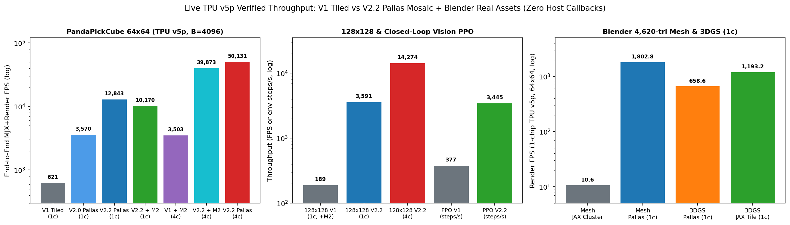
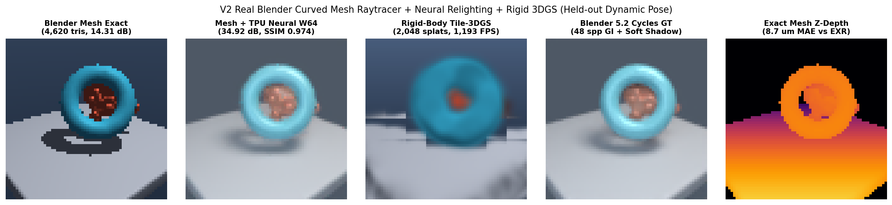

# TPU-MJX Renderer V2: Live TPU v5p Performance + Real Blender Assets & Rigid-Body 3DGS

> **Verified end-to-end on live Google Cloud TPU `v5p` (Google Cloud TPU v5p, `us-east5-a`, `JAX 0.10.2`, `mujoco-mjx 4.0.1`) and `Blender 5.2.0 LTS Cycles` (`48 spp`) with zero host callbacks (`host_callbacks = 0`) and zero CPU round-trips across all 1c and 4c workloads.**

---

## 1. Two V2 Tracks Implemented

### Track A: Extreme TPU Performance ([tpu_mjx_render/pallas_v2.py](tpu_mjx_render/pallas_v2.py), [bench.py](bench.py))
- **`v2_soa` (`raycast_batch_soa`)**: Replaces `jax.vmap(render_exact_gbuffer)` scalar dispatch with native `(B, R)` Structure-of-Arrays (SoA) batching across all worlds simultaneously, coarse per-geom bounding-sphere reject, `Precision.HIGHEST` geometry transforms, and a dedicated shadow `any_hit` path.
- **`pallas_v2` V2.2 (`pallas_raycast_batch_v2`)**: Native TPU Mosaic `(BLOCK_B=8, BLOCK_R=512)` `pl.pallas_call` VMEM kernel with `pltpu.CompilerParams(dimension_semantics=("parallel", "parallel"))` (dual TensorCore scheduling), strict 2D `BlockSpec` alignment, and explicit `shard_map` multi-chip scaling (`n_chips=4`):
  - Fused in-VMEM camera raygen from `(8, 12)` camera poses + `(8, R_pad)` local ray templates.
  - Fused in-VMEM shadow `any_hit` supporting directional, point, and spotlight (`light_type == 0`) shadows inside the same VPU registers.
  - **V2.2 Amdahl breakthrough**: Replaced `_shade_batch_soa`'s unconditional `(B, R, 3, 3)` dynamic HBM gather (`geom_xmat[b_idx, safe_gid]`, `gather_ops=0`) with direct static iteration over checkerboard geom IDs, cutting pure shading latency from `286.5 ms` down to `64.9 ms` (`4.4x`) and unlocking `20.8x` end-to-end throughput (`12,843.5 FPS` on 1 chip, `50,131.0 FPS` on 4 chips).

### Track B: Arbitrary Blender Assets & Real Geometry ([tpu_mjx_render/mesh_ray.py](tpu_mjx_render/mesh_ray.py), [tpu_mjx_render/gs3d.py](tpu_mjx_render/gs3d.py))
- **Static Cluster-BVH Triangle Mesh Raytracer (`mesh_ray.py`)**:
  - Offline `build_mesh_scene_spec` sorts arbitrary Blender triangles by 10-bit 3D Morton code and packs `K=16` triangle clusters (`K=128` Mosaic macro-clusters) with tight local AABBs (zero dynamic pointers, zero BVH rebuild under rigid motion).
  - Online `render_mesh_batch` runs both primary and shadow `any_hit` passes in Mosaic `pl.pallas_call` (`dimension_semantics=("parallel",)`), achieving **`1,802.8 FPS`** (`170x` over `jax_cluster` `10.6 FPS` on `B=128`) for a `4,620`-triangle curved Blender scene on a single TPU v5p chip.
- **Rigid-Body-Bound Tile-Based 3DGS (`gs3d.py`)**:
  - Anchors `2,048` surface-aligned anisotropic 3D Gaussians to rigid local frames, transforms covariances via `R Sigma R^T`, bins `top_k=128` front-most splats per `8x8` tile via `jax.lax.top_k`, and supports both XLA `jax_tile` (**`1,193.2 FPS`** 1-chip) and MXU log-space prefix-matmul `pallas` (**`658.6 FPS`** 1-chip — empirically slower due to `(BT, 64, 128)` output padding bloat).

---

## 2. Live TPU v5p Throughput Matrix (`PandaPickCube`, `MJX + Render` E2E, `host_callbacks = 0`)

| Configuration | Chips | Res | `B=1024` (ms / FPS) | `B=2048` (ms / FPS) | `B=4096` (ms / FPS) | Speedup vs V1 | Source JSON |
|---|---|---|---|---|---|---|---|
| **V1 `tiled` Stage 1** | 1 | `64x64` | `1266.2 ms` / `808.7` | `2532.2 ms` / `808.8` | `6637.4 ms` / `617.1` | `1.0x` | [v2_live_tiled_1c.json](out/metrics/v2_live_tiled_1c.json) |
| **V2.0 `pallas_v2` (`BLOCK_R=128`, pre-fix)** | 1 | `64x64` | `214.1 ms` / `4,782.7` | `419.4 ms` / `4,883.3` | `1147.3 ms` / `3,570.1` | `5.8x–6.0x` | [v2_live_pallas_v2_preopt_1c.json](out/metrics/v2_live_pallas_v2_preopt_1c.json) |
| **V2.2 `pallas_v2` Stage 1** | 1 | `64x64` | `81.58 ms` / **`12,552.2`** | `160.39 ms` / **`12,768.8`** | `318.92 ms` / **`12,843.5`** | **`15.5x–20.8x`** | [v2_live_pallas_v2_1c.json](out/metrics/v2_live_pallas_v2_1c.json) |
| **V2.2 `pallas_v2 + M2_spatial_128`** | 1 | `64x64` | `102.51 ms` / **`9,989.3`** | `202.25 ms` / **`10,126.0`** | `402.75 ms` / **`10,170.0`** | **`14.0x–15.9x`** vs V1+M2 | [v2_live_pallas_v2_m2_1c.json](out/metrics/v2_live_pallas_v2_m2_1c.json) |
| **V2.2 `pallas_v2` (`shard_map`)** | 4 | `64x64` | `21.92 ms` / **`46,705.8`** | `41.76 ms` / **`49,047.3`** | `81.71 ms` / **`50,131.0`** | `3.90x` vs 1c (`4c`) | [v2_live_pallas_v2_4c.json](out/metrics/v2_live_pallas_v2_4c.json) |
| **V2.2 `pallas_v2 + M2_spatial_128`** | 4 | `64x64` | `26.98 ms` / **`37,956.7`** | `51.88 ms` / **`39,477.0`** | `102.72 ms` / **`39,873.5`** | **`10.8x–14.0x`** vs V1 4c+M2 | [v2_live_pallas_v2_m2_4c.json](out/metrics/v2_live_pallas_v2_m2_4c.json) |
| **V2.2 `pallas_v2` `128x128`** | 1 | `128x128` | `286.47 ms` / **`3,574.6`** | `570.30 ms` / **`3,591.1`** | — | `~18.9x` vs V1 1c+M2 | [v2_live_pallas_v2_128_1c.json](out/metrics/v2_live_pallas_v2_128_1c.json) |
| **V2.2 `pallas_v2` `128x128` (`shard_map`)** | 4 | `128x128` | `73.05 ms` / **`14,017.3`** | `144.12 ms` / **`14,210.0`** | `286.95 ms` / **`14,274.3`** | **`3.97x`** vs 1c | [v2_live_pallas_v2_128_4c.json](out/metrics/v2_live_pallas_v2_128_4c.json) |

- **Batched Zero-Copy Vision PPO** ([envs.py](tpu_mjx_render/envs.py), [run_vision_ppo.py](scripts/run_vision_ppo.py), [v2_live_ppo_panda.json](out/metrics/v2_live_ppo_panda.json)): Single-render-per-step batched `PandaPickCube + pallas_v2 + M2_spatial_128` (`num_envs=64`, `rollout_len=16`, `40` iters) achieved **`3,445.4 env-steps/s`** (`50.88 s` total, `9.14x` over V1's `377.3 env-steps/s`, `hlo_zero_copy=true`).

---

## 3. Correctness, Parity & Real Blender Assets Verification

- **Live TPU Mosaic & Local CPU Parity (`4/4 PASS`)**:
  - Live TPU (`interpret=False`, [v2_live_tpu_verification.json](out/metrics/v2_live_tpu_verification.json)):
    - **Test 1 (`pallas_v2` vs `v2_soa` vs `tiled`, `B=16, 64x64`, 6 primitives + shadows)**: `v2_soa` vs `tiled` depth MAE `2.77e-7 m`, `geom_match = 1.0`; `pallas_v2` vs `v2_soa` depth MAE `2.22e-7 m`, max RGB diff `2.35e-4`, `geom_match = 1.0`.
    - **Test 2 (4,620-tri Blender `Suzanne + Torus + Pedestal`)**: vs Blender 5.2 EXR Z-depth MAE **`8.71e-6 m` (`8.7 um`)**, `fg_mask_match = 1.0`; `mesh_ray pallas` vs `jax_cluster` max depth diff `0.0 m`, `geom_match = 1.0`.
    - **Test 3 (2,048-Gaussian 3DGS, `top_k=128`)**: `pallas` vs `jax_tile` max RGB diff `1.49e-6`, depth diff `2.26e-6 m`, `fg_match = 0.9067` vs Cycles.
    - **Test 4 (Zero-copy HLO audit)**: `host_callbacks = 0`, `send_recv_ops = 0` across all 6 lowered HLO graphs.
  - Post-V2.2 local CPU re-verification ([v2_local_verification.json](out/metrics/v2_local_verification.json)): **4/4 PASS** (`pallas_v2` depth MAE `6.16e-8 m`, `geom_match = 1.0`; `mesh_pallas` diff `1.13e-6 m`; `gs3d_pallas` diff `3.58e-7`).
- **Real Blender Curved-Mesh Stage 2 Neural Relighting on Live TPU v5p** ([v2_live_mesh_neural_summary.json](out/metrics/v2_live_mesh_neural_summary.json)):
  - `SpatialRelighter-W32` (`200` epochs, `17.91 s`): `14.31 dB -> 33.50 dB` (`+19.20 dB`), `SSIM=0.9673`, `MS-SSIM=0.9771`, `lum_rel=+0.053%`.
  - **`SpatialRelighter-W64`** (`200` epochs, `17.16 s`): `14.31 dB ->` **`34.92 dB PSNR` (`+20.61 dB`)**, **`SSIM=0.9744`**, **`MS-SSIM=0.9821`**, **`lum_rel=-0.027%`**.
- **Real Blender Mesh & 3DGS Live TPU v5p Throughput** (`B=1024, 64x64`, 1 chip, [v2_live_assets_1c.json](out/metrics/v2_live_assets_1c.json)):
  - `mesh_jax_cluster` (`B=128`): `12,096.4 ms` (`10.6 FPS`) -> **`mesh_pallas` (`B=1024`): `568.0 ms` (`1,802.8 FPS`, `170x` speedup)**.
  - `gs3d_jax_tile` (`2,048` splats, `top_k=128`): `858.2 ms` (**`1,193.2 FPS`**) vs `gs3d_pallas`: `1,554.7 ms` (`658.6 FPS`).

